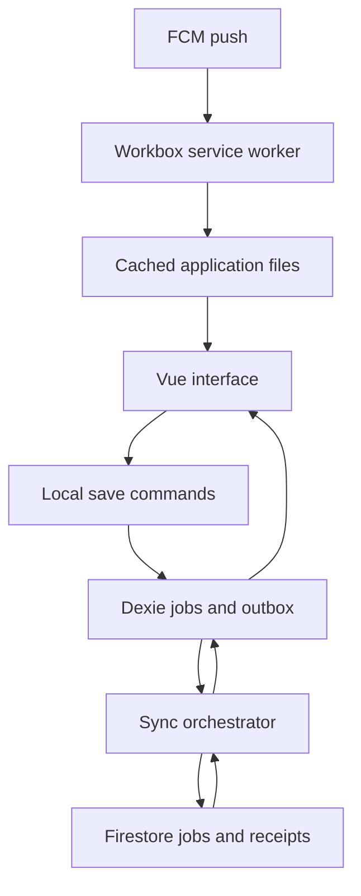
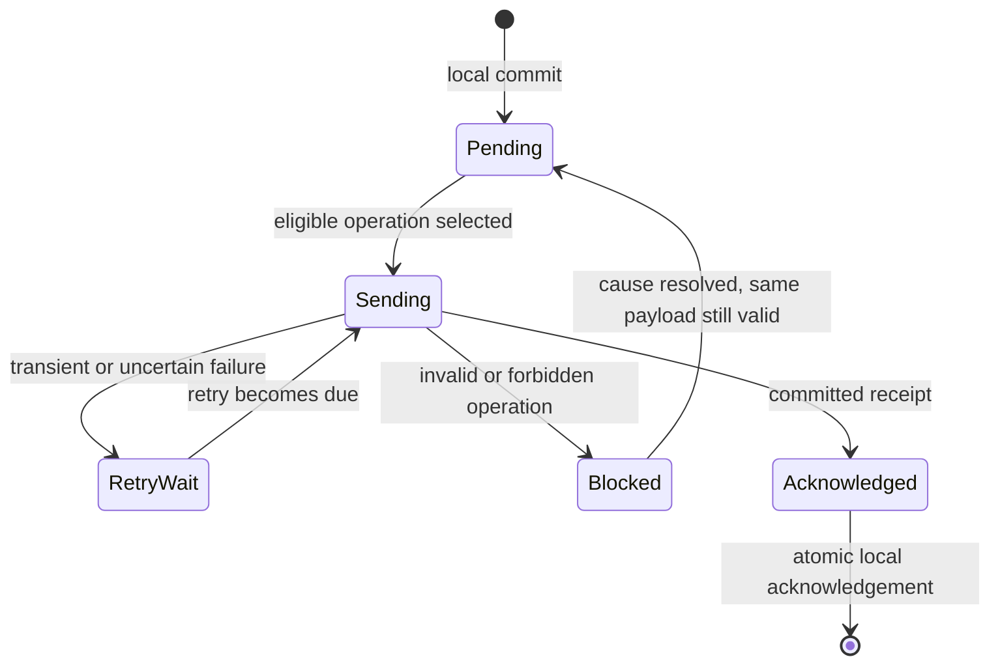

# FE-03 — Offline-First Progressive Web App with Sync Engine

**Complete implementation workflow and Codex handover**  
Prepared for Rachit Panwar · 24 October 2026  
Assignment: Frontend Development, Project #2 of 2  
Batch start: 20 October 2026 · Deadline: 20 November 2026 · Stated effort: 14 days

This is a detailed specification for work to be implemented. It does not claim that an application, Firebase project, deployment, notification, or test result already exists. The schedule and performance budgets below are planning targets, not measured results.

## 1. Start here: what we are building

Build **FieldLog**, a small field-service job tracker that remains useful without internet. A technician can view downloaded jobs, create a job, edit details, record progress, and delete a job locally. Those changes survive an ordinary app restart and synchronize with the same user's Firebase data when connectivity and authentication allow it.

The core demonstration is: open the prepared app offline, edit a job, close and reopen it, see the edit still there, reconnect, and see the change arrive on another device. Then demonstrate retries and conflicts without losing unrelated edits or applying the same operation twice.

The job tracker is a deliberate choice from the assignment's two allowed options. It demonstrates the sync requirements without introducing binary-file upload complexity. File attachments, maps, invoicing, team dispatch, and customer accounts are not part of this baseline. An optional attachment extension is described separately near the end.

This project uses Vue 3. Do not copy the React component library from FE-01 into it or add a React runtime just to reuse that work. Visual ideas and CSS tokens can be reused when appropriate, but this is a separate deliverable with its own implementation and evidence.

### 1.1 Master instruction to give Codex

Place this file in the intended project directory and paste this instruction into Codex:

> Read FE-03-Codex-Project-Workflow.md completely. Treat it as the specification for my offline-first Vue job tracker. Inspect the repository and applicable instructions first. Implement the project in phases, starting with one durable local create/edit flow and a real sync round trip. Use the required Vue 3, Vite, Dexie, Workbox/service-worker, and Firebase stack. Keep the architecture and code minimal, readable, and correct. Follow the explicit queue, idempotency, conflict, deletion, account-isolation, and acknowledgement rules in this document. Continue locally achievable work without repeatedly asking about routine implementation choices. Record actual progress, tests, and blockers in docs/progress.md. Prepare account-dependent work when credentials are missing and continue independent tasks. Do not claim an emulator test proves real push delivery, a local save proves cloud sync, or a configured deployment has actually deployed. Respect existing permissions and authorization for external actions; this handover alone does not authorize publishing or sending messages.

### 1.2 Requirement versus implementation choice

| Category | Meaning in this guide |
|---|---|
| Required by the supplied brief | Vue 3, Vite, Dexie/IndexedDB, Workbox/service workers, Firebase sync queue, conflict handling, installation, push notifications, offline testing, and listed deliverables |
| Proposed app scope | Single-account job tracker; same user on two devices; no collaborative team role model |
| Proposed engineering choices | TypeScript, Firebase Auth + Firestore + FCM + Hosting, direct Firestore transactions, durable operation receipts, Vitest, Playwright |
| Optional | Attachments, automatic backend-triggered notifications, closed-app background sync, incremental pull, richer collaboration |
| Blocked | Required work awaiting access or another dependency; configuration-ready does not mean complete |

The original brief mentions Lighthouse PWA audits. Current Chrome documentation marks those old PWA checks deprecated. Use the current available Lighthouse categories plus explicit install/offline/service-worker checks and document the difference; do not manufacture a PWA score [R01].

## 2. Product scope and user experience

### 2.1 Main screens

| Screen | Contents and purpose |
|---|---|
| Sign in | Simple Firebase email/password authentication; clear offline-first-use explanation |
| Jobs | Search, status filter, responsive list, pending/failed sync indicators, create action |
| Job details | Job fields, progress controls, notes, last known sync state, edit/delete actions |
| Job editor | Short form with validation; explicit Save; separate draft from persisted record |
| Sync center | Pending changes, errors, retries, conflict outcomes, last server check, manual Sync now |
| Settings | Account, install help, notification opt-in, storage information, export, update availability |

Use Vue Router for a small set of routes. Prefer ordinary accessible form controls and a compact responsive layout. One global stylesheet and component-scoped styles are sufficient. Tailwind, Storybook, and a component-library publishing pipeline are not requirements for FE-03.

### 2.2 Required user actions

1. Sign in online once using an account that can also be used on a second browser/device.
2. Load existing jobs from Firebase into local storage.
3. Create a job with a title, customer/site details, description, priority, status, and optional due date.
4. Edit selected fields without replacing unrelated fields.
5. Change status among `scheduled`, `in_progress`, and `completed`.
6. Delete a job with confirmation; retain a synchronization tombstone.
7. Search and filter downloaded jobs entirely locally.
8. See whether changes are saved locally, pending, syncing, failed, or fully acknowledged.
9. Trigger sync manually and recover from a temporary network failure.
10. Review the outcome when two devices edit the same job.
11. Install the PWA in a supported browser and reopen its cached shell offline.
12. Opt in to a real push notification and open the relevant job from it.

### 2.3 Honest product promises

- Local Save succeeds only after the IndexedDB transaction commits.
- Offline access covers the cached application and data already stored on that device.
- A first-ever visit to a never-cached application cannot load without a network.
- First sign-in, password reset, and fetching new remote records require network access.
- The baseline sync engine runs while an app page is active and on reopening. It does not promise to synchronize after every tab is closed.
- The browser can suspend background tabs; a reconnect event is an opportunity, not a guaranteed immediate execution slot.
- Browser storage is not an unlimited permanent backup. Quotas, eviction, user clearing, and private-mode behavior must be handled honestly [R02].
- Push notifications are useful hints. They are not the source of data truth and are not guaranteed delivery.

Do not bury these distinctions in the final presentation. They explain the actual engineering boundary of the project.

## 3. Keep the implementation lean

Use one Vue application repository and one package manager. FE-03 does not require a monorepo. Introduce the following small, explicit boundaries:

| Concern | Implementation approach |
|---|---|
| UI | Vue single-file components with Composition API and TypeScript |
| Application data | Dexie is the durable local source for rendered jobs |
| Temporary form data | Vue refs/reactive state until explicit Save |
| Cloud transport | One Firestore adapter module |
| Synchronization | One orchestrator plus small pure merge/rebase helpers |
| Offline app assets | One Workbox service worker |
| Authentication | One Firebase Auth integration |
| Push | FCM using the same service-worker registration |
| Tests | Vitest for logic/storage; emulator tests for Firebase; Playwright for browser flows |

Avoid Pinia initially unless actual shared UI-state complexity justifies it. Do not mirror all jobs into a second state store. A small composable can subscribe to Dexie live queries and unsubscribe on unmount; the Observable can be consumed directly without adding RxJS solely for this purpose [R03].

Use plain functions and a few clear data types. A generic repository framework, plugin-based sync architecture, event bus, dependency-injection container, or universal conflict engine is unnecessary for one entity type.

The few extra records used for queue durability, remote snapshots, and receipts are justified by concrete failure cases. Keep them; remove speculative abstractions around them. Code length is not a correctness metric. Aim for the fewest moving parts that preserve required behavior.

## 4. Architecture and source-of-truth boundaries



There are three distinct storage responsibilities:

1. **Cache Storage:** application HTML, bundled scripts, styles, and local icons. This makes the interface available offline.
2. **IndexedDB through Dexie:** job projections, last confirmed server snapshots, the outbox, sync metadata, and conflict notices. This makes user work durable locally.
3. **Firestore:** canonical account-scoped jobs and immutable operation receipts. This connects devices and confirms what the server accepted.

All user edits first go through local commands, even while online. Do not implement separate online-write and offline-write code paths. The UI renders local data, and the sync engine updates that local data after verified remote results.

Configure Firestore with memory caching for this project and do not enable a second persistent Firestore cache. Its SDK already has its own offline behavior [R04], but the assignment needs an explicit Dexie queue. Restrict business writes to online transactions; those transactions fail offline [R05]. This makes the application outbox the durable delivery mechanism and avoids opaque queued `setDoc` operations competing with it.

A successful network request is not enough if it only returned stale SDK cache data. Use server-backed reads for reconciliation and receipts, and recognize failures rather than treating cache results as acknowledgement.

## 5. Concrete data contracts

These are proposed domain contracts. Codex must validate them consistently in forms, local commands, sync payload handling, and Firestore rules.

### 5.1 Job fields

```ts
type JobStatus = 'scheduled' | 'in_progress' | 'completed';
type JobPriority = 'low' | 'normal' | 'high';

type JobFields = {
  title: string;
  customerName: string;
  siteAddress: string;
  description: string;
  notes: string;
  status: JobStatus;
  priority: JobPriority;
  dueDate: string | null; // calendar date: YYYY-MM-DD
};
```

Recommended initial limits: title 1–120 characters, customer name 1–120, site address up to 300, description up to 2,000, notes up to 4,000. Trim where appropriate without unexpectedly altering meaningful multiline notes. Validate that dates exist in the Gregorian calendar; do not accept 31 February. Dates are date-only values, not UTC midnight timestamps.

Strings and enums keep field-level merging understandable. Notes are one field: concurrent edits to different paragraphs are still a same-field conflict. This baseline does not claim character-level collaborative text merging.

### 5.2 Canonical remote job

```ts
type RemoteJob = {
  schemaVersion: 1;
  id: string;                  // UUID, generated once on the device
  ownerId: string;             // authenticated Firebase UID
  fields: JobFields;
  deleted: boolean;
  revision: number;            // 1, 2, 3... per job, transaction-controlled
  lastOpId: string;
  updatedAt: unknown;          // actual implementation: Firestore Timestamp
};
```

Use the correct imported Firestore timestamp type in production code. `unknown` here keeps the conceptual contract independent of SDK imports. Never store a timestamp sentinel as if it were already a resolved timestamp. `revision` is the authoritative ordering value for copies of the same job; the timestamp is for display/diagnostics.

Keep `ownerId`, `id`, and schema version immutable for a record. Deletion is terminal for that UUID in the baseline. Creating a replacement job uses a new ID.

### 5.3 Local job projection

For each job, store the most recent confirmed remote snapshot or `null`, plus the locally displayed projection and a monotonic local edit counter. A job created offline has no server snapshot yet.

Conceptually:

```ts
type LocalJob = {
  id: string;
  shadow: RemoteJob | null;
  view: { fields: JobFields; deleted: boolean };
  localVersion: number;
  localUpdatedAt: number;
};
```

The view is derived from the confirmed shadow plus outstanding operations in local sequence. It may be materialized for convenient queries, but it must be rebuilt transactionally whenever the shadow or relevant queue changes. Do not let view and shadow silently diverge.

Local timestamps support display and retry scheduling. They do not decide cross-device conflict winners because clocks may be wrong.

### 5.4 Outbox operation

Separate an immutable command payload from mutable delivery bookkeeping:

```ts
type OperationPayload = {
  protocolVersion: 1;
  opId: string;
  ownerId: string;
  deviceId: string;
  jobId: string;
  kind: 'create' | 'patch' | 'delete';
  baseRevision: number | null; // diagnostic base; not a global ordering clock
  baseValues: Partial<JobFields>;
  patch: Partial<JobFields>;
  after: JobFields;           // full intended state, for staged record-LWW tests
  clientCreatedAt: number;
};

type OutboxRow = {
  sequence?: number;          // allocated monotonically by IndexedDB
  payload: OperationPayload;
  state: 'pending' | 'sending' | 'retry_wait' | 'blocked';
  attempts: number;
  nextAttemptAt: number | null;
  lastErrorCode: string | null;
  lastErrorMessage: string | null;
};
```

For create, `after` contains all valid fields. For patch, `patch` includes only fields explicitly changed; `baseValues` contains the corresponding values the editor started from. For delete, the body is retained locally for recovery/diagnostics, but the server applies a tombstone rather than a full replacement.

`opId` is created once and reused on every retry. A modified command gets a new ID. Delivery counters/state may change; payload content may not. Do not compact, rewrite, or merge queued operations in the first implementation. Stable small commands make recovery much easier to prove.

### 5.5 Server receipt

For each successfully processed operation, write an immutable receipt in the same Firestore transaction as the job mutation. Include operation identity, protocol version, job ID, outcome, canonical result snapshot, bounded conflict details, and server receipt time.

Outcomes: `applied`, `noop`, or `rejected_deleted`. A validation or permission rejection is an error and does not fabricate a success receipt. Repeated processing of a previously completed operation returns its existing receipt and does not modify the job again.

Store enough request identity, such as the immutable request fields, to detect reusing an opId for a different command. A request fingerprint is an alternative only if canonical serialization is well-defined and tested. Avoid introducing hashing infrastructure without a need; these payloads are small and bounded.

Keep receipts for the project's lifetime. Deleting receipts while old devices can retry undermines deduplication. Production retention requires an explicit replay horizon or acknowledgement protocol, not an arbitrary cleanup timer.

### 5.6 Conflict notice

For each conflicting field record base value, incoming value, remote value at resolution, chosen result, reason, job ID, and opId. Store notices separately from mutable job state so a later pull does not erase the explanation. Only show necessary values to the signed-in owner. Never log account credentials or FCM tokens with conflict information.

## 6. Local schema and account separation

Use one Dexie database per Firebase project/environment and UID, for example a sanitized name derived from `fieldlog:<projectId>:<uid>`. This prevents development/emulator data and different accounts from being mixed accidentally.

Suggested stores:

| Store | Key/index purpose | What belongs here |
|---|---|---|
| `jobs` | Primary ID; useful status/due-date indexes if measured necessary | Shadow and visible job projection |
| `outbox` | Auto sequence; unique payload opId; job ID; state | Durable commands and retry bookkeeping |
| `conflicts` | Stable notice ID, job ID, opId | Bounded merge outcome explanations |
| `meta` | String key | Last successful pull, schema/protocol metadata, environment |

Dexie supports nested key paths; use the actual stored shape when defining indexes. For example, an index on `payload.opId` must not be incorrectly declared as a nonexistent top-level `opId`. Verify duplicate-operation prevention in tests.

Keep the device ID in durable installation metadata with a clear scope. Sequence allocation must happen inside the same database transaction as the save and queue insertion, so two tabs cannot allocate the same sequence manually. UUIDs identify records; numeric sequence orders local commands.

Use versioned Dexie migrations. Never delete the database to fix a schema mismatch during normal startup. Handle `blocked` and `versionchange` events with an update/close-other-tabs message. A migration must preserve jobs, outbox payloads, retry state, and account identity.

Remote schema version and local database version are separate concepts. Changing a local index need not change the wire protocol. Changing receipt interpretation or delete semantics may require a protocol version change and compatibility handling.

## 7. Firebase project structure and security boundary

Use Firebase Authentication for identity, Firestore for jobs and receipts, Cloud Messaging for push, and Hosting for a straightforward HTTPS deployment. Cloud Functions are optional, not required for the core sync algorithm.

Suggested paths:

| Firestore path | Purpose |
|---|---|
| `users/{uid}/jobs/{jobId}` | Canonical jobs, including tombstones |
| `users/{uid}/operations/{opId}` | Immutable idempotency receipts |
| `users/{uid}/devices/{deviceId}` | Notification registration metadata and token |

The two-device demonstration uses the same authenticated UID on both devices. Two unrelated anonymous sessions do not automatically share an account. Use a dedicated demo email/password account; keep its password out of the repository and evidence files.

Rules must enforce account ownership on every relevant path. Validate permitted keys, types, lengths, enum values, record ID, and protocol/schema version. Preserve immutable metadata. Allow initial revision 1 and increment it exactly once for an actual change. Require authoritative timestamps where used.

Reject physical deletion of canonical job records in this baseline; delete through a tombstone update. Reject updates and deletions of completed receipts. Link job mutations to their corresponding receipt within the atomic write using appropriate `getAfter` checks, staying within rules evaluation limits [R06]. Noop/rejected-deleted receipts legitimately reference an unchanged job, so rules must model those cases rather than requiring every receipt to increment a revision.

Firestore rules validate access and structural integrity. The conflict algorithm runs in the authenticated client transaction for this single-owner project. Do not claim that this is a centrally enforced collaboration service: a sufficiently privileged owner client can choose different values within its own allowed schema. Moving conflict decisions to a trusted endpoint is a future production-hardening option.

Use the emulator and explicit rule tests. The Admin SDK bypasses Firestore rules, so a successful administrative seed or read is not proof that normal client permissions work [R07].

## 8. Phase 0 — Inspect, decide, and prepare the environment

**Purpose:** identify constraints before installing tools or inventing architecture.

1. Inspect repository files, Git status, applicable AGENTS.md instructions, and existing application code.
2. Preserve unrelated work. Do not reinitialize Git or replace a functioning app without a concrete reason.
3. Verify supported stable versions of Node/npm, Vue, Vite, TypeScript, Dexie, Firebase, Workbox, and the PWA plugin. Record the versions actually installed, rather than copying an old tutorial's package combination.
4. Choose one package manager and commit its lockfile. npm is the default for this guide.
5. Check Firebase CLI and the emulator's current Java/runtime prerequisites. Install only what the selected emulator versions require; Docker is unnecessary.
6. Create `docs/progress.md`, `docs/decisions.md`, and a compact requirement-to-evidence checklist.
7. Record the chosen conflict meaning: server-commit-order LWW first, then field-level merge with the same tie-break for overlapping fields; terminal deletion wins.
8. Record the supported baseline browsers. Test current Chrome/Edge first, then document Firefox/Safari results where accessible. Do not promise identical installation or push behavior everywhere.
9. Identify external dependencies: Firebase project access, Auth provider, Firestore, FCM/VAPID configuration, GitHub, hosting, a second browser/device, and Google Drive submission folder.
10. Confirm that account-dependent work will be reported blocked until actually completed.

**Gate:** the environment, requirements, and next implementation step are clear, and there is no accidental production access in local tests.

## 9. Phase 1 — Scaffold a small Vue application

Use the official Vue/Vite setup appropriate to the installed version [R08]. Select TypeScript, Vue Router, Vitest, linting, and formatting where supported. Add Playwright for real-browser verification. Use the Composition API with `<script setup lang="ts">`.

Suggested locations, not a demand for unnecessary one-function files:

| Path | Responsibility |
|---|---|
| `src/main.ts`, `src/App.vue` | Startup and application shell |
| `src/router.ts` | Small route map |
| `src/domain.ts` | Job/operation types and field validation |
| `src/db.ts` | Dexie definition, migrations, account-scoped lifecycle |
| `src/jobs.ts` | Local create/edit/delete commands |
| `src/firebase.ts` | Firebase initialization, emulator configuration |
| `src/auth.ts` | Auth lifecycle and active-account context |
| `src/sync/engine.ts` | Scheduling and bounded sync cycles |
| `src/sync/remote.ts` | Firestore reads, transactions, and receipt handling |
| `src/sync/merge.ts` | Pure LWW/field merge and projection rebuilding |
| `src/composables/useJobs.ts` | Dexie subscription for UI |
| `src/views/`, `src/components/` | Screens and genuinely reused UI |
| `src/sw.ts` | Workbox precache, navigation fallback, FCM handling |
| `src/notifications.ts` | Permission and foreground/token integration |
| `public/` | Local manifest icons and intentional static assets |
| `tests/` | Unit/storage, emulator, and browser tests |
| `scripts/send-test-push.mjs` | Trusted local push sender, outside browser bundle |
| `firestore.rules`, `firebase.json` | Access policy, emulator and hosting configuration |
| `docs/` | Architecture, sync contract, progress, evidence |

Begin with a working job list and editor driven by a small in-memory fixture, then replace the data access with Dexie in the next phase. Do not spend days polishing animations before local persistence works.

Establish the following commands. These are the script contract Codex must implement, not scripts already present in an empty directory:

| Command | Expected purpose |
|---|---|
| `npm run dev` | Start local Vue development |
| `npm run build` | Type-check and build production assets/service worker |
| `npm run preview` | Serve the production build for local PWA testing |
| `npm run lint` | Check source conventions |
| `npm run typecheck` | Explicit Vue/TypeScript checks |
| `npm test` | Run fast unit/storage tests once |
| `npm run test:watch` | Develop against relevant tests |
| `npm run test:coverage` | Coverage including untested core modules |
| `npm run emulators` | Start configured Auth and Firestore emulators |
| `npm run test:rules` | Run ownership/schema rule tests against emulators |
| `npm run test:sync` | Run real Firestore-protocol integration tests |
| `npm run test:e2e` | Run browser scenarios against production output |
| `npm run check` | Lint, type-check, fast tests, and build |

Keep commands usable on Windows PowerShell and Linux CI. Prefer small Node helpers over shell-specific deletion, copying, or environment syntax when necessary.

**Gate:** the application runs, an actual form interaction is tested, type checking works, and a production build succeeds.

## 10. Phase 2 — Durable local creation and editing

**Purpose:** prove offline data correctness before adding the network.

### 10.1 Create a job

1. Validate the form.
2. Generate a job UUID and operation UUID once.
3. Capture the account context and device ID.
4. Start a Dexie read-write transaction covering jobs and outbox, plus metadata if needed.
5. Insert the visible job with `shadow: null`.
6. Insert the immutable create operation and pending delivery metadata.
7. Commit the transaction.
8. Show “Saved on this device — pending sync.”
9. Trigger a sync request after the commit; do not wait for cloud access to finish saving.

### 10.2 Edit a job

The editor keeps an initial field snapshot and a draft. Calculate the patch from fields the user actually changed. Do not send every field from a stale form as a full replacement.

Inside one Dexie transaction, read the latest visible job, validate that it is editable, apply the dirty-field patch to that view, and enqueue the corresponding operation. Preserve the editor's original values for changed fields as `baseValues`; these explain a conflict if a remote or other-tab edit happened while the form was open. Keep the latest unrelated fields from the database.

Increment localVersion and update localUpdatedAt. If there is no real field change, do not create a meaningless operation. The Save button must indicate an actual local storage failure rather than reporting success on a rejected transaction.

### 10.3 Delete locally

Confirm the action, mark the local view deleted, and enqueue a delete command atomically. Hide deleted jobs from the ordinary list but retain the data needed for sync and recovery. An offline-created-then-deleted job may initially replay create followed by delete; do not add queue compaction until the basic protocol is proven.

### 10.4 Transaction boundary

Do not make Firebase calls, fetch requests, timer waits, or unrelated asynchronous work inside a Dexie transaction. IndexedDB transactions can become inactive or commit prematurely when control leaves the database work [R09]. Local persistence and remote delivery are separate transactions coordinated by the durable outbox.

Subscribe to Dexie changes for the UI. Dispose subscriptions on unmount and account changes. Search and status filtering run on local records; they must not require Firestore access.

**Gate:** create, edit, delete, search, reload, and close/reopen work against Dexie; a simulated local write failure cannot create a job without its queue entry or a queue entry without its job.

## 11. Phase 3 — Authentication and safe account lifecycle

Use email/password Firebase Auth for a small demo sign-in/sign-out flow. A registration screen is optional; the owner can provision a demo account. A password-reset flow is optional, not required to demonstrate sync.

Initialize the configured Auth persistence before starting sync. Wait for the initial auth restoration event to distinguish “still loading identity” from “signed out.” Use the restored authenticated user to select the correct Dexie database; do not treat an arbitrary UID stored in localStorage as proof of identity [R10].

After a prior successful sign-in, allow the supported restored session to view and edit its local account data offline. Remote authentication may still require token refresh when connectivity returns. If the token cannot be refreshed, pause cloud delivery and preserve the queue. Offline availability is not proof that server-side access has not been revoked.

Every sync cycle captures an immutable context: project ID, UID, database handle, and session generation. Before starting remote work and before applying a callback to the UI, verify that the context is still current. A late response for account A must never write into account B's database or screen.

On sign-out:

1. Stop scheduling new work for that session.
2. Wait for or safely detach from an in-flight attempt without falsely declaring it cancelled.
3. Explain any pending local changes. Offer to remain signed in and sync, or deliberately sign out while retaining account-isolated local work.
4. Dispose live-query subscriptions, notification foreground handlers, and screen data.
5. Complete Auth sign-out and return to the signed-out screen.
6. Retain the account database by default so unsynced work is not silently destroyed. Offer a separate explicit device-data removal action with a pending-change warning/export option.

Restore retained data only when the same account signs in again. Do not automatically migrate account A's queue to B. Handle Auth changes propagated from another tab as well as the local logout button.

Stop displaying account-specific push content on a shared device after sign-out. Delete/unregister the FCM token where feasible and remove its server registration while authenticated; record best-effort cleanup limitations when offline. Use generic notification wording to reduce exposure from already-sent messages.

**Gate:** the same account works on two clients, a different account cannot access its remote or rendered local data, and sign-out with pending work has an intentional documented outcome.

## 12. Phase 4 — The first real sync round trip

**Purpose:** deliver one queued create operation to Firestore and acknowledge it safely.

Initially run sync through a manual Sync now action. Automatic triggers come after correctness. Use the Auth/Firestore emulators for repeatable development, followed by a real project smoke test when authorized.

### 12.1 Remote transaction protocol

`applyOperation(context, payload)` does the following:

1. Validate operation shape, protocol version, owner, ID formats, and bounded field sizes before transport.
2. Construct paths from the captured UID and validated IDs. Do not accept arbitrary Firestore paths from a payload.
3. Start an online Firestore transaction.
4. Read the receipt at `operations/{opId}`.
5. If it exists, verify that its stored request identity matches this immutable operation. Return the previous outcome without another mutation. Reusing an ID with different content is a protocol error.
6. If no receipt exists, read the job document.
7. Resolve the command against the current job using the selected merge policy and deletion rules.
8. If content changes, write the canonical result with its revision incremented, lastOpId, and server timestamp.
9. Write the immutable operation receipt in the same transaction, including the canonical result and merge outcome.
10. After the transaction succeeds, retrieve/resolve the committed receipt from the server so all server timestamps and canonical values are real, not local sentinels.
11. Return the committed receipt to the local acknowledgement function.

Firestore may rerun a transaction callback when concurrent data changes. Keep it pure with respect to external effects: no Dexie writes, no notifications, no UI mutations, and no new random operation IDs inside the callback. All reads must precede its writes [R05].

For an already completed receipt, a subsequent server read can still fail due to connectivity. Treat that as uncertain delivery and keep the same operation queued. The next attempt will find the receipt again.

### 12.2 Create behavior

A create to a previously unused job ID writes revision 1. If the same opId already has a receipt, reuse it. If the job exists with a different creation history, block the conflicting create; do not overwrite an unrelated record just because UUID collisions are unlikely.

Creating a job that has an existing tombstone is also rejected. A tombstone deliberately reserves the ID against resurrection.

### 12.3 Local acknowledgement protocol

After receiving a committed receipt, open one Dexie transaction covering jobs, outbox, conflicts, and relevant metadata:

1. Find the exact outbox row by opId. If already acknowledged by an earlier callback, treat the duplicate acknowledgement as harmless.
2. Load the latest local job and its shadow, rather than the object captured before the network request.
3. Accept the receipt result as a new shadow only if its per-job revision is newer than the stored one, or initializes a missing shadow. An older receipt must not roll a job backwards.
4. Delete only the acknowledged operation's queue row. Never delete every pending operation for the job.
5. Persist conflict notices with stable IDs so duplicate callbacks do not duplicate notices.
6. Read the remaining operations for that job in local sequence.
7. Rebuild the visible projection over the latest shadow using those outstanding local changes.
8. Commit everything atomically.

This protects edits made while a request is in flight. Example: operation A changes status; the user adds notes as operation B before A is acknowledged. A's acknowledgement updates the shadow and removes A, then reapplies B. The new notes stay visible and pending.

### 12.4 Delivery guarantees

Network delivery is **at least once**: retries can submit the same request again. The receipt and atomic transaction make its state-changing effect idempotent while receipts are retained. Do not claim magical exactly-once network delivery.

If the server commits and the response is lost, the queue remains. Retry with the same opId returns the receipt and finishes local acknowledgement without incrementing the job revision twice.

**Gate:** one real create reaches Firestore, receives a receipt, disappears from the pending queue only after acknowledgement, and remains correct when the response is intentionally dropped and retried.

## 13. Phase 5 — Queue scheduling, retries, and crash recovery

### 13.1 Queue state machine



Acknowledged is a conceptual transition: completed rows are removed from the outbox in the acknowledgement transaction. Remote receipts retain the delivery evidence. Application crashes can leave a local row marked sending; this does not prove that a request is still active.

### 13.2 One active coordinator per local account

Use a same-origin Web Lock named by environment and UID for the complete sync cycle. This coordinates tabs sharing the same local database [R11]. Hold the lock across operation selection, remote processing, acknowledgement, and reconciliation. Keep local editing outside this network lock so saves remain responsive.

Feature-detect the Web Locks API. The baseline supported browsers must provide it. If unavailable, show a clear compatibility message and keep local work usable; do not silently run an unsafe multi-tab sync loop. A tested IndexedDB lease/fencing fallback is an optional enhancement, not a requirement to hand-wave into a few lines.

The lock coordinates tabs on one origin; it does not coordinate two devices. Cross-device correctness comes from Firestore transactions and receipts.

On acquiring the lock after startup/crash, recover stale sending rows into an eligible retry state. Receipt checking makes retrying an uncertain remote result safe. Never reset a sending row from another tab while that tab still holds the same lock.

### 13.3 Eligibility and ordering

Process operations sequentially initially. Select the earliest due operation that has no earlier unacknowledged operation for the same job. A retry-wait or blocked operation holds later operations for that job. Other jobs may continue, preventing one invalid record from freezing all work.

Creation must be acknowledged before its later patches or delete are sent. Even when a patch appears independent, preserve per-job order to retain the user's sequence of changes and the meaning of its base values.

Use a bounded batch, for example up to 25 operations or a 15-second scheduling budget checked **between requests**. Yield and schedule another cycle if eligible work remains. These are tunable project defaults, not guarantees about request completion times.

Do not use `Promise.race` with a timer and then assume the original Firestore write was cancelled. If a request is still unresolved, keep its identity and coordinator ownership until it settles or the page genuinely closes. Display a stalled/in-progress status and allow local editing. Avoid launching a replacement worker on top of the original request.

### 13.4 Retry behavior

Persist attempts, nextAttemptAt, and sanitized error details. A starting backoff policy is exponential delay with bounded jitter, beginning around 2 seconds and capped around 60 seconds. Reset the error state after a verified success. Use injected time/randomness in tests so retry tests are deterministic.

| Failure class | Behavior |
|---|---|
| Network unavailable, timeout, uncertain response | Preserve payload; back off and retry with the same opId |
| Transient transaction contention | Allow SDK retries; if exhausted, retry later through outbox |
| Authentication refresh required | Pause delivery and ask for reauthentication; keep local work |
| Permission denied | Stop automatic retries for affected work; show actionable error |
| Invalid data or unsupported protocol | Block the operation; do not repeatedly send unchanged invalid data |
| Local quota/storage failure | Fail the local save visibly; retain form input |
| Remote job already deleted | Use terminal deleted outcome and recovery UI |
| Receipt identity mismatch | Block as a protocol error; never reuse the ID for a different request |

Manual Retry can clear the delay for a transient failure. It must not erase an error explanation, mutate the command, or repeatedly bypass an unresolved permission problem.

### 13.5 Trigger policy

Request a cycle after: a local save, successful sign-in/restoration, a browser online event, visibility returning to the page, an explicit Sync now action, and a modest visible-page timer such as once per minute. Coalesce triggers into one requested run and use the lock to avoid overlaps.

`navigator.onLine` is a hint, not proof that Firebase is reachable [R12]. Do not prevent local editing based on it. If a user requests a sync, permit a bounded server attempt even when the hint is pessimistic; actual Firebase responses determine connectivity/auth outcomes. Avoid an unrelated public “ping” service.

**Gate:** transient failures back off, permanent failures are visible, later operations do not overtake an earlier operation for the same job, another job can progress, and reopening recovers uncertain operations.

## 14. Phase 6 — Pulling remote changes without losing local work

### 14.1 Simple baseline reconciliation

For the assignment's small dataset, use an explicit server-backed full read of the user's jobs collection, including tombstones. This avoids designing a fragile timestamp cursor before the app works. Record that this is intended for tens to a few hundred records and incurs reads proportional to dataset size; measure the actual cost/latency profile rather than claiming unlimited scale.

A sync cycle should generally reconcile, push a bounded batch, then reconcile again. A preliminary read failure does not authorize skipping ownership/auth checks. Network/auth failures normally pause the cycle; isolated item validation failures need not stop unrelated valid jobs.

### 14.2 Apply a remote snapshot locally

For every returned document, validate schema/owner/ID and compare its revision with the stored shadow. Ignore older versions. For a newer revision, update the shadow and rebuild the visible projection with outstanding local commands in the same Dexie transaction.

If there are no pending operations, the view becomes the canonical remote state. If pending patches exist, show the remote state plus those still-unacknowledged intentions. A local create not present on the server remains local and pending.

Do not interpret “not in this read” as deletion. Deletion is communicated through a retained tombstone. Query errors, pagination mistakes, permissions, or partial reads must never trigger mass local deletion.

Update `lastSuccessfulPullAt` only after the intended validated snapshot has been applied. Keep `lastSuccessfulPushAt` separate if shown. “No pending uploads” is not proof that this device contains every newest remote change.

### 14.3 Monotonicity and acknowledgement races

Two asynchronous responses can arrive out of order. The shadow must only advance by per-job revision. A receipt from revision 5 arriving after a pull of revision 6 acknowledges its own operation but must not replace the revision-6 shadow.

Outstanding operations may briefly overlay changes already accepted remotely but not locally acknowledged. Keep the UI status pending until the receipt is processed; idempotent absolute assignments and sequential acknowledgement resolve this state. Never resend the same change with a fresh opId merely because a pull saw a different revision.

Use an equality check for same-revision conflicting snapshots. Treat such a mismatch as data/protocol inconsistency to diagnose, not as a reason to arbitrarily overwrite a confirmed shadow.

### 14.4 Later scaling option

Incremental pull is optional. A correct design must handle equal timestamps, stable ordering, deletions, late commits, and cursor persistence only after local application. Do not implement `updatedAt > lastSeenDate` and assume it cannot skip records. For the baseline, the simple full reconciliation is preferable to an unproven cursor protocol.

**Gate:** changes from device B appear on A after reconciliation while A's unsent edits remain intact, and older responses cannot roll local state backwards.

## 15. Phase 7 — Conflict handling in two explicit stages

The assignment asks for last-write-wins first, then field-level merging. Implement these as pure tested resolvers, demonstrate their difference, and ship the field-merge policy as the final default. Do not let different live clients silently select incompatible policies for the same dataset. Use isolated test fixtures or emulator resets for the staged comparison.

### 15.1 Define what “last” means

This project's LWW means **last successful server commit**, serialized through Firestore's transaction on that job. It does not mean the largest device `Date.now()` value. A device that reconnects later can win an overlapping field even if its edit was made earlier in real time. Explain this tradeoff plainly.

Per-job revision provides an unambiguous order of accepted mutations. Server timestamps are useful for display but are not used as a tie-breaker that must be predicted before commit.

If the assessor expects client-edit-time LWW, that requires a different documented clock/ordering policy. Do not silently claim to implement both interpretations.

### 15.2 Stage A: record-level LWW

For a non-deleted existing job, replace its business fields with the command's intended `after` state. Preserve immutable metadata, advance revision, and write the receipt atomically. This gives a simple initial baseline but can lose unrelated concurrent changes.

Example: both devices start with title “Boiler inspection” and status scheduled. A changes status to completed and syncs. B changes title while offline and later sends its full old snapshot. Record LWW can restore status scheduled. Demonstrate this known weakness in tests, not in an unannounced production behavior change.

### 15.3 Stage B: field-level merge

For each field in the immutable patch, compare three values: base value the editor saw, incoming desired value, and current remote value.

| Comparison | Interpretation | Result |
|---|---|---|
| Field absent from patch | User did not change it | Keep current remote value |
| Incoming equals base | No effective local change | Keep current remote value |
| Remote equals base | Only this local change differs | Apply incoming value |
| Remote equals incoming | Both reached the same result | Keep value; no conflict notice needed |
| All three differ | Same field changed concurrently | Apply incoming by server-commit LWW and record both versions |

The comparison uses values, not a claim to detect every historical edit. A remote field that changed and returned to its original value looks unchanged; documenting this limitation is acceptable for the baseline.

Never merge metadata such as ownerId, ID, schema version, or revision through user patches. They are protocol-controlled. Empty strings and `null` are explicit values; a missing patch key means leave the field alone. Do not accidentally treat `undefined`, omitted, empty, and deleted as equivalent.

Illustrative result:

| Step | Title | Status |
|---|---|---|
| Both devices start | Boiler inspection | scheduled |
| A syncs a status patch | Boiler inspection | completed |
| B syncs a title patch | Boiler inspection — urgent | completed |

Both edits survive because they touch different fields. If both devices change `notes`, one complete notes value wins by the stated policy; the other appears in the conflict explanation. Do not describe this as paragraph-level merging.

### 15.4 Same-field recovery

Show a compact Sync center notice: which field conflicted, incoming/remote values, and which value was chosen at that time. Clearly distinguish the historical outcome from today's current value, which may have changed again.

Provide a deliberate “Use this value” recovery action for an editable, non-deleted job. It creates a new patch operation against the latest local view with a new opId. It does not alter the old receipt or silently replay a rejected payload.

### 15.5 Delete versus update

Use a terminal tombstone rule:

- Delete after an update marks the job deleted.
- Update after a committed delete returns `rejected_deleted`; it cannot recreate the job.
- Repeated delete can return a noop receipt referencing the tombstone.
- New create with a tombstoned ID is blocked.

When a remote tombstone arrives while local edits remain, hide the job from the normal active list and show a recoverable “Deleted on another device; local edits preserved” item in Sync center. Do not silently discard those edits. After the operation receives its terminal outcome, remove only that acknowledged row; move dependent unsendable edits into an explicit blocked/recovery state.

Keep the terminal shadow authoritative for visibility. Outstanding patch operations cannot make a deleted record reappear. Recovery creates a new job UUID from selected retained values, and the UI explains that it is a replacement, not a resurrection.

Do not garbage-collect tombstones during the project. Removing them while an old offline device can send stale updates creates resurrection risk.

### 15.6 Test the resolver independently

Tests must cover: disjoint fields in both arrival orders; overlapping fields in both arrival orders; identical changes; omitted versus null; empty notes; stale full snapshot in LWW stage; sequential same-device edits; delete/update in both orders; duplicate delete; update against missing record; and a clock-skewed client that cannot win simply through a future timestamp.

Property-style assertions are useful: unrelated fields remain unchanged; inputs are not mutated; outputs preserve valid schema; revisions change only for actual mutations; and a repeated completed operation has no additional effect.

**Gate:** the weaker record-LWW behavior is demonstrated, final field merging preserves unrelated edits, and same-field/deletion outcomes are predictable and visible.

## 16. Phase 8 — Workbox service worker and offline app shell

Use `vite-plugin-pwa` with Workbox and an explicit custom worker through `injectManifest`. The plugin bundles the worker and injects revisioned asset entries; the custom worker allows one place for caching, update messages, and FCM integration [R13].

### 16.1 Cache policy

Precache the built app shell, bundled scripts/styles, locally hosted icons, and offline-required static assets. Ensure lazy-loaded job/editor/sync routes are included in the production precache or are intentionally prepared before the offline claim. Testing only the initial route is insufficient.

Handle in-scope navigation requests with the cached app shell so Vue Router can resolve deep links offline. Exclude auth callback paths or other routes that must not receive the SPA shell. Align Vite base, router base, manifest scope/start URL, and service-worker scope.

Do not cache Firebase Auth, Firestore RPC responses, FCM endpoints, or user-specific API data indiscriminately with Workbox. Business records belong in Dexie. Prefer locally bundled fonts/icons to runtime third-party CDN dependencies. If a remote image is optional, supply a clear offline fallback.

Use Workbox precache revisioning and remove only obsolete app-owned caches. Never delete all origin caches indiscriminately or clear IndexedDB during activation. Precache handles versioned assets; it does not synchronize the user's jobs [R14].

### 16.2 Registration and readiness

Register one worker for the app scope. Use either the plugin's documented registration helper or your own explicit path, not both. Show an offline-ready message only after essential assets are cached and the page is under the intended worker's control.

Service workers require a secure context, with normal localhost development exceptions. Test the production build and HTTPS deployment. A Vite development server successfully serving a page is not proof that the deployed service worker works.

### 16.3 Update lifecycle

Use a prompt-based update flow: “A new version is ready.” Do not force reload while a user has an unsaved form or a sync request is being acknowledged.

Before applying an update, ensure drafts are explicitly saved/discarded and local transactions have completed. Pending durable outbox entries can survive a reload, but confirm their schema/protocol remains compatible. In-flight remote requests may have uncertain outcomes after reload; the same opId/receipt recovery must handle them.

Activate the waiting worker only through the documented update handshake, then reload once. Handle other tabs using an older version and IndexedDB upgrade blocking. Avoid automatic repeated reload loops.

Test old and new builds on the same origin without clearing site data. Verify jobs and pending operations survive, obsolete caches are removed appropriately, and deep routes still load offline.

### 16.4 Scope of background work

The required baseline does not run the Firestore sync engine in the worker. Workbox Background Sync is designed around replaying requests and is not automatically a safe wrapper for authenticated Firestore SDK transactions [R15]. Do not maintain a second Workbox request queue for the same business changes.

An advanced closed-app sync feature would need an explicit authenticated transport, compatible worker environment, and the same idempotency protocol. Browser scheduling still limits guarantees. Complete foreground/reopen sync first.

**Gate:** after preparation, the production app opens, refreshes, and navigates among required routes offline; updates preserve unsynced work.

## 17. Phase 9 — Installation and push notifications

### 17.1 Web app manifest

Provide name, short_name, description, stable id, start_url, scope, display mode, theme/background colors, and local icon assets. Supply appropriate regular and maskable icons, including common 192 and 512 pixel sizes, and inspect their appearance. Do not label an ordinary icon maskable unless its artwork respects the safe area.

Choose standalone display for the installed experience. Verify the manifest URLs match the actual deployment base. Installation support and prompts vary by browser; provide a user-triggered install action when supported and concise platform instructions otherwise [R16].

Never show a fake success message when installation was merely offered. Detect installed display mode where appropriate and keep the browser version usable. Installation is not a prerequisite for ordinary offline editing after the service worker has prepared the app.

### 17.2 Notification permission and token lifecycle

The manifest does not implement push notifications. Use Firebase Cloud Messaging with notification permission, a supported browser, valid web-push/VAPID setup, and the existing service-worker registration [R17].

1. Feature-detect service workers, Notification support, and the Firebase messaging capability check.
2. Show an explanation and an “Enable notifications” button in Settings.
3. Request permission only after the user's action, not immediately on page load.
4. Handle default, granted, denied, and unsupported states without blocking the rest of the app.
5. Obtain the FCM registration token using the configured public VAPID key and the app's actual worker registration.
6. Store the token in the authenticated owner's device document, not in a public collection or source file.
7. Reconcile the registration on supported startup/login and permission changes; handle token changes without creating unlimited stale device records.
8. Provide Disable notifications. Remove/delete the registration where possible and handle offline cleanup explicitly.

The frontend Firebase config and public VAPID key identify the app; they are not substitutes for authorization rules. Firebase Admin credentials, private keys, and privileged send capability must never enter the Vite client bundle.

### 17.3 One service worker for both caching and messaging

Initialize Firebase Messaging inside the bundled custom worker, following the supported modular worker API for the selected SDK version. Pass that same registration to getToken. Do not register a second root-scoped `firebase-messaging-sw.js` that replaces the Workbox worker [R18].

Define how notifications are displayed so a message is not shown twice. Baseline: a trusted sender sends a small data message, and the background handler explicitly displays one notification. Foreground delivery displays an in-app banner instead of a second system notification.

Use a generic title such as “FieldLog update available” and a concise body. Include a stable notification ID/tag and a job ID for navigation. Validate the message shape; no arbitrary HTML or external navigation URL is accepted.

Register the notification-click behavior in the order required by the SDK documentation. Close the notification, focus an existing same-origin application window if possible, or open a valid in-scope job route. Use an event lifetime mechanism such as `waitUntil` around asynchronous click work. The page checks identity and access before displaying the job.

A notification can refer to a record not yet downloaded or already deleted. Show a useful state and perform normal reconciliation when online. Do not treat its payload as a trusted replacement for the canonical record.

### 17.4 Minimal real push sender

For the assignment baseline, provide a small trusted local Node script using the Firebase Admin SDK to send a test message to the owner's opted-in device [R19]. Run it outside the Vite bundle with credentials provided through the supported environment/credential mechanism. Use an explicit token/device selection and project identifier; do not print tokens or credentials in reports.

This proves real remote push delivery without requiring a deployed custom backend or billing-dependent Cloud Function. Sending manually is acceptable for the stated “push notifications” capability, but document it as operator-triggered. If the assessor expects automatic job-change notifications, add a trusted backend trigger as a separately tested feature.

For an automatic trigger, use an idempotent event/notification identifier, avoid sending back to the originating device unnecessarily, and do not resend merely because a receipt was read again. Check current deployment/billing requirements before provisioning paid services. Never place Admin SDK credentials into a Vue route to avoid setting up a sender.

### 17.5 Notification evidence

Record one real foreground delivery, one background-tab/installed-app delivery on a supported device, and one notification-click navigation. Also test denied permission and unsupported capability behavior.

FCM is not fully reproduced by the Auth/Firestore emulator tests. A fake push event or a mocked handler is useful unit evidence, but cannot be reported as real FCM delivery. If the account, project, or browser is unavailable, mark that verification blocked.

Do not promise notification delivery while completely offline or after the operating system has terminated the browser. Record the exact environment and observed behavior.

**Gate:** installation is demonstrated on a supported target, real opt-in push works, click navigation is safe, and denied/unsupported states remain usable.

## 18. Sync center and recovery experience

The interface must explain what is happening without exposing implementation internals to ordinary users.

### 18.1 State wording

| Situation | User-facing wording | Meaning |
|---|---|---|
| Draft not saved | Unsaved changes | Only in the form, not yet durable |
| Local transaction committed | Saved on this device | Survives normal reload; may still need cloud delivery |
| Queue contains work | 3 changes waiting to sync | Count actual pending operations, not jobs unless labeled |
| Active request | Syncing… | A cycle is attempting server work |
| No known network access | Offline — you can keep working | Local commands remain available |
| Server unavailable despite online hint | Cannot reach the server — retrying | Distinguish browser hint from backend reachability |
| Auth needs refresh | Sign in again to sync | Local data remains preserved |
| Permission or validation blocked | Some changes need attention | Automatic retry will not solve the current issue |
| No pending work, recent pull succeeded | Up to date as of [time] | Honest snapshot of the last successful check |
| Same-field merge happened | A conflicting edit was resolved | Link to values/outcome rather than silently losing context |

Avoid a single green “Synced” badge derived only from navigator.onLine. Keep local-save state, pending delivery, last remote check, and permanent error states distinguishable.

### 18.2 Failed operation controls

Transient errors provide Retry now. Authentication errors provide sign-in guidance. Invalid data provides a safe edit-and-replace procedure that creates a new operation identity, after resolving the old uncertain operation state.

Do not let users blindly delete an uncertain sending operation and assume it never reached the server. If cancellation is offered, first determine the receipt outcome online or explain that its remote effect is unknown. A safer baseline is to keep failed operations, provide export, and allow corrective actions once the outcome is known.

A blocked operation prevents later operations for the same job from being sent. The UI should expose that dependency in plain language: “Resolve this change before later edits can sync.” It need not show sequence numbers to ordinary users.

### 18.3 Local data export

Provide a small JSON export containing the current account's locally visible jobs, confirmed shadows, pending operations, schema versions, and nonsecret diagnostic state. Exclude Auth tokens, passwords, FCM tokens, and private configuration. Name the file with a timestamp and make its purpose clear: a recovery/debug snapshot, not an encrypted backup.

Import/restore is optional. Do not promise round-trip recovery unless a validated import flow is implemented and tested. An exported file helps preserve evidence before clearing local data or diagnosing a migration failure.

### 18.4 Storage capacity and failure

Use storage estimate/persistence APIs when available, with graceful fallback. Request persistent storage at an appropriate user action and report whether it was granted; do not claim it was guaranteed. Handle quota exceptions by preserving the form and explaining that the local save failed [R02].

Never auto-delete unsynced jobs or the outbox to recover space. Reclaim disposable caches or old nonessential logs first, and only through a documented policy. The baseline's small text-only dataset avoids attachment-size pressure.

## 19. Testing architecture

The sync protocol deserves meaningful tests because errors can lose user work. Keep the test suite focused on invariants rather than mirroring implementation details.

### 19.1 Four layers

| Layer | Tools | Main responsibility |
|---|---|---|
| Pure logic | Vitest | Validation, patch generation, merging, revision selection, retry scheduling |
| Local persistence | Vitest + fake-indexeddb, then browser checks | Atomic save/outbox writes, projection replay, migrations |
| Firebase integration | Auth/Firestore emulators and rules-unit-testing | Transactions, receipts, cross-device ordering, ownership, schema constraints |
| Real browser | Playwright + manual DevTools/device checks | Service-worker caching, reloads, multi-tab coordination, UI, installation, real push |

Use Vue Test Utils or the Vue testing library for components where it adds useful interaction coverage; choose one primary style. Vitest fits the Vite stack and is a proposed choice, not an assignment-mandated runner.

fake-indexeddb does not reproduce every browser lifecycle or quota behavior. Emulator tests do not prove deployed Firebase rules, HTTPS, installation, or FCM. Keep these evidence boundaries explicit.

### 19.2 Testable boundaries

Inject a small remote adapter into the engine so tests can pause, fail, or return a receipt predictably. Inject clock and random-jitter functions into retry scheduling. Keep merge/rebase functions pure. This is sufficient testability; do not create a general dependency-injection framework.

Fault-injection helpers belong in tests or an explicitly development-only build. Production users must not receive an unauthenticated debug endpoint that deletes remote data or disables access checks.

### 19.3 Core invariants

1. A successful local save produces both the local view and its outbox operation atomically.
2. Operation identity and payload never change during retry.
3. One completed opId causes at most one canonical mutation while its receipt is retained.
4. Acknowledgement removes only the matching operation.
5. Local edits made during a request survive its acknowledgement.
6. Confirmed shadows never regress to an older revision.
7. Per-job operation order is preserved.
8. Different-field concurrent edits both survive final merging.
9. Terminal deletion cannot be undone by a stale update.
10. Account A's data or callback cannot be applied to account B.
11. Offline data access does not depend on a live Firebase read.
12. Updating the service worker does not erase application data or the outbox.

Test these directly. Counting many shallow tests is less valuable than proving the failure cases.

## 20. Detailed test matrix

Use stable IDs in the evidence report. The steps below are required scenarios for this baseline; mark unexecuted cases as Not run, never Pass.

| ID | Scenario | Procedure | Expected result |
|---|---|---|---|
| T01 | Atomic create | Save a new job and inspect Dexie | Job and create operation both exist |
| T02 | Failed local transaction | Abort/fail the queue insertion in a test | Neither half of the save persists; UI reports failure |
| T03 | Edit persistence | Edit notes, reload | Notes and pending operation remain |
| T04 | No-op save | Save an unchanged form | No extra command created |
| T05 | Stale form | Open form, update another field elsewhere, save only title | Unrelated latest field remains intact |
| T06 | Local delete | Delete offline, reload | Hidden from active list; tombstone intent retained |
| T07 | First remote create | Sync one create | Job revision 1 and matching receipt exist |
| T08 | Duplicate delivery | Submit same payload/opId twice | One canonical effect and one receipt |
| T09 | Lost response | Commit remotely, suppress response, retry | Receipt resolves uncertainty without duplicate mutation |
| T10 | Reused ID, different body | Submit different payload with old opId | Protocol error; canonical data unchanged |
| T11 | Mid-flight edit | Pause A's response, save B, then acknowledge A | B remains visible and queued |
| T12 | Failed local ack | Commit remotely, fail Dexie acknowledgement | Queue remains recoverable; retry succeeds safely |
| T13 | Crash with sending state | Close/reopen with a sending row | Lock-protected recovery retries same opId |
| T14 | Sequential operations | Queue create, patch, patch, delete for one job | Process in order; final tombstone correct |
| T15 | Blocked predecessor | Block first patch and enqueue another | Later same-job patch waits; other jobs can sync |
| T16 | Transient outage | Fail remote adapter repeatedly | Persisted bounded backoff; no busy loop |
| T17 | Manual retry | Retry a transient failure before due time | One coalesced attempt; same immutable payload |
| T18 | Permission denial | Deny write through emulator rules | Visible blocked state; no infinite retry |
| T19 | Expired auth | Make server requests require renewed authentication | Local editing remains; remote sync pauses |
| T20 | Two tabs | Open same account in two tabs and trigger sync | One local coordinator; no overtaking or duplicate effect |
| T21 | Lock-holder close | Close the active tab during delivery | Another tab can recover safely |
| T22 | Remote pull | Edit on B, reconcile A | A receives canonical changes |
| T23 | Pull with local patch | Queue title edit on A; change status on B | A keeps local title and receives remote status |
| T24 | Out-of-order responses | Apply revision 6, then receipt for revision 5 | Shadow stays at 6; correct op acknowledged |
| T25 | Record LWW limitation | Stage A: send a stale full record | Expected unrelated-field overwrite documented |
| T26 | Disjoint merge | Stage B: A changes status, B changes notes | Both changes survive in either arrival order |
| T27 | Same-field merge | Both change notes; sync in controlled order | Stated server-commit winner and conflict notice |
| T28 | Identical merge | Both set same field to same value | No false conflict; no unnecessary revision change |
| T29 | Clock skew | Set one client's clock far ahead | Clock value cannot determine winner |
| T30 | Delete then update | B deletes; A sends stale patch | No resurrection; recoverable local edit notice |
| T31 | Update then delete | A updates; B deletes | Final canonical state is deleted |
| T32 | Missing remote record | Patch nonexistent ID | Blocked error; no implicit create |
| T33 | Account isolation | Authenticate B and attempt A's paths | Rules deny; A's local data not rendered |
| T34 | Late account callback | Switch account while a response is pending | Response cannot modify new account's state |
| T35 | Offline prepared reload | Cache app, go offline, refresh deep route | Interface and downloaded data load |
| T36 | Offline first-ever visit | Fresh profile, no cache, no network | Limitation documented; no false offline-ready claim |
| T37 | Offline unvisited route | Prepare app, then open editor/sync route offline | Essential route bundles available |
| T38 | App update with queue | Install build B over A with pending changes | Data/queue preserved; update prompt behaves |
| T39 | Database migration | Upgrade fixture containing pending operations | Payloads, order, and account scope preserved |
| T40 | Storage failure | Simulate quota/write error | Form preserved; no success message or silent deletion |
| T41 | Captive/server outage | Online hint true, Firebase unreachable | Accurate retrying state; local work continues |
| T42 | Installation | Install production app on target browser | Correct name/icon/start route and standalone launch |
| T43 | Real push foreground | Send from trusted script to opted-in open app | One in-app message; receipt evidence recorded |
| T44 | Real push background | Send with app backgrounded on supported device | One system notification |
| T45 | Notification click | Click a job-related notification | Safe same-origin navigation and access check |
| T46 | Push denied/unsupported | Deny permission or use unsupported environment | App remains usable; accurate settings state |
| T47 | User sign-out with queue | Sign out while changes are pending | Explicit choice; retained account-isolated work |
| T48 | Network flapping | Repeatedly toggle connectivity during a batch | No lost acknowledged edits; eventual drain when stable |

For each scenario store commit/build, environment, steps or test name, expected result, actual result, pass/fail/not-run, and evidence location. A screenshot alone does not prove a remote write; inspect canonical data/receipts when the scenario concerns synchronization.

## 21. Browser test procedures that prove offline behavior

### 21.1 Prepared-device offline test

1. Build production assets and serve/deploy them from a stable origin.
2. Sign in online and create/download a few fictional jobs.
3. Wait for the intended worker to activate/control the page and for reconciliation to finish.
4. Confirm the expected Cache Storage entries and Dexie records in DevTools.
5. Turn on DevTools offline mode for page-level behavior.
6. Refresh a job-details route and open the editor.
7. Save a title/status/notes change. Verify the local save and pending queue.
8. Close and reopen the page using the same browser profile and origin.
9. Confirm the local edit survived.
10. Restore connectivity and verify canonical Firestore state and receipt.
11. Open another authenticated client and verify reconciliation.

Also perform an OS-level network disconnection or controlled server/network failure. Chrome's Workbox guidance warns that DevTools offline settings may not block service-worker-originated requests the same way as page requests; record what is actually blocked [R15]. Do not assume a checkbox proves every worker/push path was offline.

### 21.2 Two-device conflict test

Use two separate browser profiles/contexts or actual devices signed in to the same account. Two tabs in one profile share IndexedDB and are a multi-tab test, not a realistic independent-device conflict test.

Start both from the same canonical revision. Disconnect both. Change status on A and notes on B. Reconnect/sync A, then B, then reconcile A. Both views should converge to both edits. Repeat with both changing notes and reverse the arrival order. Record the expected last-server-commit behavior and notice content.

### 21.3 Playwright configuration

Run service-worker scenarios against a production build with service workers allowed, using an appropriate persistent or isolated browser context. Clear storage only between tests that require a clean device; do not clear it midway through a persistence/update test.

Wait on meaningful readiness conditions: worker control, a specific Dexie state, completed receipt, or visible status. Avoid arbitrary sleeps. Browser routing/mocking can interact with service workers; use the documented Playwright behavior and verify whether requests are handled by a worker [R20].

Use different contexts for independent devices and two pages in one context for multi-tab coordination. Test protocol fault injection through the adapter/emulator separately from live production network tests. Never run destructive fixture cleanup against a real Firebase project.

### 21.4 Service-worker update test

Install build A, queue an offline edit, then make build B available on the same origin. Return online and trigger the normal update discovery. Confirm a waiting update is offered, the form is preserved until saved, and applying the update keeps pending operations. Verify their final remote effect exactly once after reconnection.

If testing an IndexedDB migration, keep an old tab open deliberately to exercise upgrade blocking. The UI should request the necessary close/reload action without deleting data.

## 22. Lighthouse, accessibility, and performance evidence

### 22.1 Respond to the brief's outdated audit wording

The old Lighthouse PWA audit category is deprecated in current Chrome guidance [R01]. Record the actual Lighthouse version and available categories. Run Performance, Accessibility, Best Practices, and any useful SEO checks, then attach a separate PWA checklist covering manifest, installation, secure context, worker control, offline deep links, and update behavior.

Do not downgrade tooling merely to obtain an old “PWA 100” badge. Explain the current validation method in the report and presentation. A good Lighthouse score does not prove sync correctness or data-loss protection.

### 22.2 Accessibility baseline

Use semantic headings, buttons, labels, and meaningful status text. Support keyboard navigation through forms, dialogs, filters, and the Sync center. Associate validation messages with controls and move focus appropriately after dialog close or navigation.

Announce important save/error/sync outcomes without creating a live-region announcement for every retry timer tick. Color must not be the only pending/error indicator. Respect reduced motion and make controls usable at narrow widths and zoom.

Run automated checks where available and manually exercise the main workflow with a keyboard. A screen-reader pass on the save/error/sync states adds useful evidence. Record tested scope; do not claim complete accessibility certification from an automated score.

### 22.3 Proposed measurements

| Metric | Measurement method | Initial goal, not a result |
|---|---|---|
| Local save responsiveness | Time from Save command to IndexedDB commit and visible confirmation | Typically below 100 ms for the chosen small text fixture on the test device |
| Warm offline app load | Navigation to usable cached job list on the same profile/device | Around 1 second under documented conditions |
| Queue drain | Time to process a fixed 20-operation queue after stable connectivity | Report measured median/range; no arbitrary universal guarantee |
| Full reconciliation | Server read plus local apply for 50 and 200 jobs | Report latency and number of records/reads |
| Duplicate-effect count | Repeat completed operation IDs and inspect revisions/receipts | Zero extra canonical effects |
| Disjoint-conflict preservation | Deterministic two-client tests | Both distinct field edits preserved in every listed case |
| Production bundle | Actual build JS/CSS sizes, raw and gzip | Record baseline and explain meaningful changes |
| Lighthouse | Production build, recorded device/throttling/version | Improvement evidence, not a fabricated minimum score |

Measure durations on a single timing context or use carefully defined logs. Do not subtract timestamps from two unsynchronized devices to claim precise sync latency. Use server revisions/receipts to prove ordering, and a single observer to measure elapsed time where possible.

Repeat important timings a small number of times and report median plus range, device, browser, dataset, network, and build commit. Distinguish emulator speed from actual Firebase network performance. Do not optimize before an observed issue or add memoization/caches throughout the app merely to look advanced.

## 23. Deployment, configuration, and environment hygiene

### 23.1 Configuration

Provide `.env.example` with placeholders for the public Firebase client configuration, public VAPID key, and development-only emulator flag/ports. Validate missing config with a clear startup/setup message. Vite-exposed variables are included in the browser bundle; never use them for privileged secrets.

Keep actual local environment files ignored. Treat Firebase rules and authorized account identity as the access boundary. A web API key being visible is not equivalent to permitting unrestricted reads/writes.

Use an explicit environment selector and stable database/cache namespaces. Emulator mode must connect only to local Auth/Firestore endpoints and use a demo project identifier. Test helpers should fail closed if they detect a non-emulator target.

### 23.2 Hosting

Firebase Hosting is the baseline deployment target. Build first, deploy the intended `dist` output, configure SPA rewrites for Vue routes, and preserve valid asset/worker/manifest paths. Deploy the intended Firestore rules and indexes as well; hosted frontend success does not prove rules were updated.

Serve the service-worker script so new versions can be discovered without an excessively long immutable cache policy. Hashed static assets may use long-lived caching. Verify the generated hosting behavior on the deployed URL rather than assuming local preview matches it.

After deployment, check sign-in authorized domains, manifest, icons, worker scope, cached deep links, real Firebase synchronization, and FCM. Test an update on the same production/staging origin before final submission.

### 23.3 External authorization

Prepare and validate all local artifacts before requesting a missing deployment/account decision. If the user has already authorized a specified deployment destination or test notification, proceed within that scope. Do not treat this specification as permission to create paid resources, publish an unrelated repository, or message other people.

If Firebase access is unavailable, keep the emulator-backed implementation working and list exactly which real-environment checks remain blocked. An emulator-only project is not equivalent to a verified deployed demo.

**Gate:** the deployed application, rules, and configuration correspond to the tested release, and its real links and network behaviors are verified.

## 24. Continuous integration and release checks

Keep CI small and explicit. On pull requests and main-branch changes, install the locked dependencies, run lint/type checks/fast tests, and build the app. Run the emulator protocol/rules suite in a configured job with the required runtime. Run a focused browser suite against production output.

Recommended job order:

1. Check out the intended commit and configure the recorded Node/npm versions.
2. Install from the lockfile with `npm ci`.
3. Run lint, Vue/TypeScript checks, and unit/storage tests.
4. Start only the required emulators with isolated test project data.
5. Run rule and sync-protocol integration tests; always shut down emulator processes cleanly.
6. Build production assets and start a stable local preview server.
7. Run browser tests for prepared offline reload, pending edit recovery, and multi-tab behavior.
8. Retain relevant coverage, test reports, and failed-browser traces/screenshots.

Use the emulator's command-runner facility where it simplifies start/test/stop lifecycle. Keep production credentials out of ordinary test jobs. Untrusted pull-request code must not gain deployment or Admin credentials.

Do not mark unavailable emulator, browser, or push tests as successful. An explicit skipped job with a reason is different from a passed verification. Do not automatically accept flaky failures by adding unlimited retries; diagnose nondeterministic clocks, fixtures, worker state, and missing awaits.

Before release, reproduce the README from a clean checkout and run the complete relevant suite. Verify the generated worker and precache manifest are present, all necessary routes/assets are included, and the deployed rules are the intended version.

Create a coherent Git checkpoint/release tag when repository workflow and authorization permit. Keep real history; do not manufacture backdated commits or rewrite unrelated work to look cleaner.

## 25. Documentation and final Google Drive submission

The assignment requests a single Google Drive folder. Prepare a clear index and artifacts; upload and reviewer sharing require actual authorized Drive access. Local file creation is not proof of a Drive upload.

| Deliverable | Required content/evidence |
|---|---|
| Working demo | Real URL or screen recording showing offline save, restart, reconnect, second-device result |
| GitHub repository | Source, coherent commits, README, setup, lockfile, rules, tests, environment example |
| Architecture | Data flow, local/cloud boundaries, queue lifecycle, Workbox responsibility, authentication scope |
| Data/API documentation | Job fields, outbox schema, receipt protocol, Firestore paths, conflict/deletion policy |
| Test results | Actual T01–T48 status, command output/report references, environment and commit |
| Measurements | Local-save, offline-load, sync/reconciliation timings and honest method |
| PWA evidence | Installation, manifest, service worker, update tests, current Lighthouse report and separate PWA checklist |
| Push evidence | Opt-in and actual delivery/click results, with secret values redacted |
| Presentation | Ten-minute deck or equivalent with speaker notes and demonstration plan |
| Reflection | Authentic personal ownership, learning, challenges, limitations, and AI assistance |

Suggested folder organization: `00-Start-Here`, `01-Demo`, `02-Repository`, `03-Architecture-and-Protocol`, `04-Test-Evidence`, `05-Presentation`, and `06-Reflection`. Use a short index with actual artifact links, final commit, deployment environment, and verification date.

### 25.1 README checklist

Explain what FieldLog does, its supported baseline, first-online-use requirement, and foreground/reopen sync guarantee. Include local setup, Firebase/emulator setup, public environment variables, commands, sign-in/demo-data instructions, build/preview, real push setup, deployment, and troubleshooting.

Explain the difference between development mode and production PWA tests. Document the exact conflict policy, terminal deletion, receipt retention, full reconciliation scale limit, and browser-specific installation/push behavior.

Document that local account separation protects application behavior but does not encrypt browser files against a person who controls the device. Use fictional data for the assignment. State that retained local work remains until explicitly removed or browser storage is cleared/evicted.

### 25.2 Protocol documentation

Include a concise ordered explanation of Save → local transaction → outbox → Firestore transaction/receipt → local acknowledgement → projection rebuild. Include one duplicate-delivery example, one mid-flight edit example, one different-field merge, one same-field merge, and delete/update in both orders.

This app has an internal synchronization contract over the Firebase SDK. It does not expose a custom REST API in the baseline. Document the actual Firestore paths and operation payloads instead of inventing HTTP endpoints for the deliverable.

### 25.3 Evidence report format

```text
Release/commit:
Build URL and environment:
OS / browser / device:
Node / npm / Firebase SDK / Dexie / Workbox versions:
Dataset and account setup:
Automated commands and observed results:
Test scenario IDs with pass/fail/not-run:
Offline preparation and network-disconnection method:
Canonical receipt/revision verification:
Real push delivery evidence:
Lighthouse version and available categories:
Performance measurements and method:
Known limitations and unresolved issues:
```

Do not include passwords, Auth tokens, Admin credentials, or raw FCM registration tokens. Test screenshots should show useful application evidence without private account settings.

## 26. Ten-minute final presentation

Use a short deck and spend meaningful time demonstrating the actual behavior.

| Segment | Time | What to explain/show |
|---|---|---|
| Problem and user | 0:45 | Technician loses connectivity but still needs to work |
| App scope and architecture | 1:00 | Vue UI, Dexie, outbox, Firestore, worker assets |
| Local-first Save | 1:00 | Atomic local persistence and visible pending state |
| Offline-to-online demo | 2:30 | Disconnect, edit, reopen, reconnect, second-device result |
| Reliability and conflicts | 1:45 | Lost-response retry, distinct-field merge, same-field outcome |
| Installation and push | 0:45 | Installed launch and one real notification/click |
| Test evidence and results | 1:30 | Actual test matrix, measurements, current PWA verification |
| Limitations and next steps | 0:45 | Foreground sync, small dataset, no text CRDT/attachments |

Total: 10 minutes. Rehearse the sequence and prepare a recording backup in case venue connectivity or push delivery is unreliable. Use the same deterministic example jobs so the audience can see changes clearly.

Explain one difficult bug deeply: for example, an acknowledgement overwrote newer local notes until the view was rebuilt from the latest shadow plus pending patches. Show the failed scenario and corrected result instead of only listing tool names.

## 27. Individual reflection and ownership

The intern provides the personal facts. Codex can structure and edit them but must not invent experiences or pretend to have personally performed a manual test.

Answer these questions:

1. Which screens, persistence functions, sync behaviors, tests, and deployment tasks did I own?
2. What did I initially misunderstand about service workers versus IndexedDB?
3. Why did I choose a custom durable outbox instead of relying only on Firebase offline persistence?
4. What is the difference between at-least-once delivery and idempotent state changes?
5. Which conflict policy did I implement, and what does it still not solve?
6. Which failure case forced a change in my design?
7. What did the browser/device tests reveal that unit tests did not?
8. How did I use Codex, and how did I verify the code it produced?
9. Which optional feature did I intentionally leave out to keep the required project reliable?
10. What would I change before using this application for a real field-service team?

## 28. Schedule and implementation checkpoints

The formal assignment window began on 20 October; this guide is prepared on 24 October. Adapt dates to work already completed. The 14-day estimate is aggressive if you are also learning service workers and synchronization.

FE-01 and FE-03 share the 20 November deadline. Their estimates total 28 focused workdays, so do not assume each can independently consume all remaining time. Track both projects and use clear feature boundaries, supporting libraries, and early account setup.

### 28.1 Suggested calendar milestones

| Window | Target outcome | Proof before expanding |
|---|---|---|
| 24–27 October | Scope, scaffold, local saves, Auth/emulators | Offline data survives reload; queue is atomic |
| 28 October–1 November | Real push/pull protocol, receipts, retries | Lost response and mid-flight edit tests pass |
| 2–6 November | Field merging, deletion, two-device flows | Conflicts converge under stated policy |
| 7–11 November | Workbox, installation, updates, FCM | Offline routes and real push are demonstrated |
| 12–16 November | Full verification, fixes, measurements, deployment | Release candidate meets required gates |
| 17–19 November | Submission assets and rehearsal | All links/evidence checked; known gaps explicit |
| 20 November | Deadline | Submit before the assessor's actual cutoff |

The supplied brief does not state a submission time. Do not assume 11:59 PM; verify the actual cutoff through the assignment platform if needed and aim to be ready a day earlier.

### 28.2 Fourteen focused work sessions

| Session | Primary deliverable |
|---|---|
| 1 | Scaffold, contracts, emulator setup, initial UI |
| 2 | Dexie create/edit/delete and atomic queue tests |
| 3 | Auth lifecycle, account database separation, remote first create |
| 4 | Receipts, duplicate delivery, lost-response recovery |
| 5 | Safe acknowledgement, pending rebase, multi-tab coordinator |
| 6 | Pull reconciliation, retry/backoff, errors and Sync center |
| 7 | Record LWW demonstration and field-merge implementation |
| 8 | Delete conflicts and two-device integration tests |
| 9 | Workbox assets, offline routes, installation |
| 10 | Worker updates and database migration verification |
| 11 | Real FCM opt-in, sender, delivery, click handling |
| 12 | Remaining browser/rules tests, accessibility, measurements |
| 13 | Deployment, documentation, evidence collection |
| 14 | Final fixes, presentation, reflection, submission verification |

These are scope checkpoints, not promises that every row takes exactly one day. Re-estimate after the first real sync and after the first two-device conflict test. Protect testing time rather than filling the schedule with optional UI features.

### 28.3 Daily Codex workflow

Read progress, choose one concrete outcome, define the relevant invariant, implement the smallest change, run the appropriate tests, inspect behavior, review the diff, and update the progress file. At a milestone, run broader checks and record a coherent checkpoint.

Do not ask Codex to generate the entire application in one unreviewed step. Review the first local save and the first remote acknowledgement carefully; those patterns will determine the quality of the rest of the app.

## 29. Optional extensions after the baseline

### 29.1 Attachments

The selected job-tracker baseline does not require them. If added later, store a Blob plus metadata in IndexedDB, use Firebase Storage for bytes, and keep upload state separate from the Firestore job operation. Define file-size/type limits, pending previews, stable storage keys, cancellation, orphan cleanup, and account-scoped Storage rules.

Do not put large base64 files inside Firestore documents or assume a Firestore transaction atomically uploads a Storage object. Use an explicit two-stage protocol and recovery for partial upload/metadata failures. Verify the selected Storage service's current provisioning and billing requirements before enabling it.

If you switch to the assignment's notes-with-attachments option, attachments become part of the selected baseline and need their own tests; they cannot remain a decorative upload button.

### 29.2 Automatic notifications

Add a trusted job-change trigger with deduplicated notification IDs, token cleanup, and source-device suppression. Measure/limit sends. A push failure must not roll back a saved job or cause duplicate job edits.

### 29.3 Closed-app background sync

Design a worker-compatible authenticated transport that reuses immutable operation IDs and atomic server processing. Keep the existing durable outbox authoritative. Test browser scheduling and unsupported cases. Do not equate a registered sync event with guaranteed execution.

### 29.4 Larger datasets and collaboration

Introduce a correct incremental feed/cursor only when full reconciliation is measurably unsuitable. Add team permissions, assignments, shared ownership, server-enforced merge policy, audit history, or text CRDTs only as explicit additional scope. Each adds correctness and security obligations beyond this single-owner app.

## 30. Final acceptance checklist

- [ ] Vue 3 and Vite application builds reproducibly from the lockfile.
- [ ] Dexie stores the user's jobs and durable sync commands locally.
- [ ] Create/edit/delete and queue insertion are atomic.
- [ ] Previously prepared app and data are usable after offline reload/reopen.
- [ ] Workbox caches all required routes/assets and avoids caching account APIs blindly.
- [ ] The manifest and installation flow work on a recorded supported target.
- [ ] Custom outbox processing delivers actual changes to Firebase.
- [ ] Retries reuse the same immutable operation ID/payload.
- [ ] Atomic server receipts prevent duplicate canonical effects.
- [ ] Acknowledgement cannot overwrite a newer local edit.
- [ ] Pull reconciliation cannot regress a confirmed revision or erase pending work.
- [ ] Per-job ordering and multiple tabs are handled intentionally.
- [ ] Record-level LWW is demonstrated and final field-level merge is implemented.
- [ ] Same-field conflict outcomes are documented and visible.
- [ ] Tombstones prevent resurrection from stale offline edits.
- [ ] Auth and local/remote account boundaries are tested.
- [ ] Permanent errors and authentication failures are actionable without deleting user work.
- [ ] Worker/database updates preserve jobs and pending operations.
- [ ] Real permission-based push delivery and click navigation are demonstrated.
- [ ] Required tests have actual results, with blocked/not-run cases identified.
- [ ] Current Lighthouse results are supplemented by an explicit PWA verification checklist.
- [ ] Measured results identify device, data, method, environment, and commit.
- [ ] Working demo, GitHub, architecture, protocol/data docs, and setup instructions are available.
- [ ] Ten-minute presentation and authentic reflection are complete.
- [ ] Submission folder and reviewer access have been verified.

## 31. Progress format and smaller Codex prompts

### 31.1 Progress entry

```text
Date and commit:
Current phase:
Behavior now implemented:
Invariant or bug addressed:
Commands run and actual results:
Browser/device checks performed:
Required external work: complete / blocked / not run
Known limitations:
Decisions and reasons:
Next three tasks:
Exact owner action needed, if any:
```

### 31.2 Prompt A — Local foundation

> Read the complete handover. Implement Phases 0–2 with the smallest clear Vue structure. Build real local job create/edit/delete, Dexie persistence, and an atomic outbox. Add meaningful failure tests. Keep Firebase access explicit and do not implement a separate direct-online-write UI path. Update progress with actual results.

### 31.3 Prompt B — Reliable synchronization

> Continue from the existing project and progress file. Implement Phases 3–6: Auth/account isolation, atomic Firestore receipts, same-opId retry, safe local acknowledgement/rebase, Web Lock coordination, backoff, and remote reconciliation. Prove duplicate delivery, lost response, and edits during an in-flight operation. Preserve local work on failures.

### 31.4 Prompt C — Conflict semantics

> Implement and test Phase 7's staged record-LWW and final field-level merging. Use server commit order, immutable field patches, and terminal tombstones. Record same-field outcomes and provide deliberate recovery. Test two independent device contexts in both arrival orders; do not confuse two tabs with two devices.

### 31.5 Prompt D — PWA and push

> Implement Phases 8–9 using one Workbox/FCM service worker. Verify production offline deep routes, update prompts, database migration safety, manifest/installation, notification opt-in, and safe click navigation. Prepare the trusted local sender. Report real FCM verification as blocked until actually executed with authorized access.

### 31.6 Prompt E — Verification and submission

> Run the relevant T01–T48 checks and fix demonstrated defects. Produce the current Lighthouse report plus separate PWA checklist, measured performance evidence, architecture/protocol documentation, and a release candidate. Prepare presentation and reflection materials from real work. Deploy/upload/send test notifications only within existing authorization for the named destination. Keep missing external steps explicit.

### 31.7 Lean-code review instruction

> Review the implemented code for unnecessary wrappers, state duplication, unused dependencies, speculative features, redundant configuration, and premature optimization. Simplify only where required behavior and data integrity remain intact. Preserve atomic local writes, immutable outbox payloads, receipts, acknowledgement rebasing, tombstones, ownership checks, and meaningful tests. Explain material simplifications and rerun affected verification. Optimize understandable complexity rather than arbitrary line count.

## 32. References and technical verification

Guidance was checked on 24 October 2026. Use official documentation matching the versions installed during Phase 0. The job schema, queue protocol, retry defaults, schedule, and acceptance criteria are project design decisions; the references support the underlying platform behavior.

| ID | Official/primary reference | Purpose |
|---|---|---|
| R01 | [Chrome: deprecated Lighthouse PWA checks](https://developer.chrome.com/docs/lighthouse/pwa/installable-manifest) | Correct interpretation of the assignment's old audit wording |
| R02 | [MDN: storage quotas and eviction](https://developer.mozilla.org/en-US/docs/Web/API/Storage_API/Storage_quotas_and_eviction_criteria) | Persistence, quota, and browser-storage limits |
| R03 | [Dexie liveQuery](https://dexie.org/docs/liveQuery%28%29) | Reactive local-data subscriptions |
| R04 | [Firestore offline data](https://firebase.google.com/docs/firestore/manage-data/enable-offline) | SDK persistence and its separate offline behavior |
| R05 | [Firestore transactions](https://firebase.google.com/docs/firestore/manage-data/transactions) | Atomic operations, callback retries, offline limitations |
| R06 | [Firestore rule conditions](https://firebase.google.com/docs/firestore/security/rules-conditions) | Ownership checks and atomic-write validation |
| R07 | [Firestore rules emulator tests](https://firebase.google.com/docs/firestore/security/test-rules-emulator) | Client-rule testing and Admin distinction |
| R08 | [Vue quick start](https://vuejs.org/guide/quick-start.html) | Supported application scaffold |
| R09 | [Dexie transactions](https://dexie.org/docs/Dexie/Dexie.transaction%28%29) and [premature commit errors](https://dexie.org/docs/DexieErrors/Dexie.PrematureCommitError) | Local transaction boundaries |
| R10 | [Firebase Auth persistence](https://firebase.google.com/docs/auth/web/auth-state-persistence) | Session restoration and persistence choices |
| R11 | [MDN: Web Locks](https://developer.mozilla.org/en-US/docs/Web/API/Web_Locks_API) | Same-origin coordination across tabs |
| R12 | [MDN: navigator.onLine](https://developer.mozilla.org/en-US/docs/Web/API/Navigator/onLine) | Connectivity hints and their limits |
| R13 | [Vite PWA injectManifest](https://vite-pwa-org.netlify.app/guide/inject-manifest) and [registration](https://vite-pwa-org.netlify.app/guide/register-service-worker) | Custom worker build and registration |
| R14 | [Workbox precaching](https://developer.chrome.com/docs/workbox/modules/workbox-precaching) | Revisioned asset caching |
| R15 | [Workbox Background Sync](https://developer.chrome.com/docs/workbox/modules/workbox-background-sync) | Replay behavior and offline-testing caveats |
| R16 | [MDN: making PWAs installable](https://developer.mozilla.org/en-US/docs/Web/Progressive_web_apps/Guides/Making_PWAs_installable) | Manifest and installation behavior |
| R17 | [FCM web setup](https://firebase.google.com/docs/cloud-messaging/web/get-started) | Permission/token/VAPID setup |
| R18 | [FCM web message handling](https://firebase.google.com/docs/cloud-messaging/web/receive-messages) | Existing-worker integration and foreground/background behavior |
| R19 | [FCM Admin SDK sending](https://firebase.google.com/docs/cloud-messaging/send/admin-sdk) | Trusted remote notification sender |
| R20 | [Playwright service workers](https://playwright.dev/docs/service-workers) | Real-browser service-worker testing |

When a version-specific API differs from an example, adjust implementation syntax and record the decision while preserving the requirements and invariants. Never silently remove a difficult requirement because a generated scaffold does not provide it.
