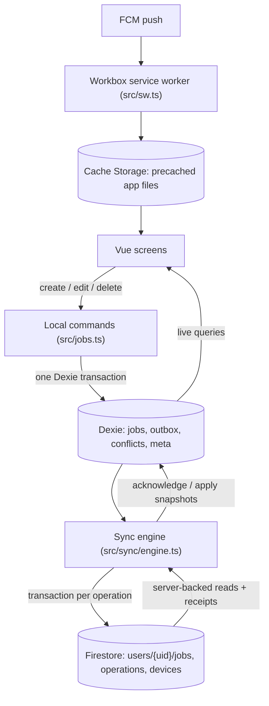
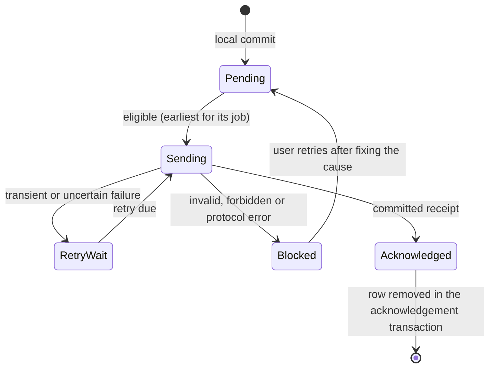

# Architecture

FieldLog is one Vue 3 application. All user edits go through local commands that write IndexedDB
first. A sync engine delivers those changes to Firestore and folds the server's confirmed results
back into the local data. The UI only ever renders local data.



## Storage responsibilities

| Store | Holds | Purpose |
|---|---|---|
| Cache Storage (Workbox precache) | `index.html`, all built JS/CSS chunks (including lazy routes), icons, manifest | The app opens and navigates offline |
| IndexedDB via Dexie, one database per project + UID | `jobs` (confirmed shadow + visible view), `outbox` (immutable operations + delivery bookkeeping), `conflicts` (notices), `meta` (device ID, last pull/push, notification opt-in) | Local work is durable and survives reloads |
| Firestore | `users/{uid}/jobs/{jobId}` (canonical jobs and tombstones), `users/{uid}/operations/{opId}` (immutable receipts), `users/{uid}/devices/{deviceId}` (push registration) | Connects devices; records what the server accepted |

The Firestore SDK uses a **memory cache only**. The app's outbox is the one durable queue, and
business writes are online transactions, so there is no hidden second queue. The worker never
caches Firebase or API traffic.

## Modules

| Module | Responsibility |
|---|---|
| `src/domain.ts` | Contracts (`JobFields`, `JobSnapshot`, `LocalJob`, `OperationPayload`, `OutboxRow`, `Receipt`, `ConflictNotice`), validation, patch generation, request comparison. No SDK imports. |
| `src/db.ts` | Dexie schema (versioned), account database naming, device ID, upgrade-blocked notices. |
| `src/jobs.ts` | Local commands: create, edit (changed fields only), delete, "use this value", recover a deleted job as a replacement, export. |
| `src/sync/merge.ts` | Pure resolvers: staged record-LWW and final field merge, terminal deletion, local projection rebuild, revision comparison. |
| `src/sync/remote.ts` | Firestore adapter: `applyOperation` transaction, receipt parsing, full server-backed job read. |
| `src/sync/local.ts` | Dexie side of sync: select eligible operation, mark sending/failed, acknowledge receipts, apply pulled snapshots, recover interrupted rows. |
| `src/sync/engine.ts` | Scheduling: Web Lock, cycle, backoff, triggers, status, discard-after-receipt-check. |
| `src/sync/errors.ts` | Failure classes (transient, auth, blocked) and user-facing wording. |
| `src/auth.ts`, `src/firebase.ts` | Firebase init, auth restoration, per-account session (database + engine + generation). |
| `src/sw.ts`, `src/pwa.ts`, `src/notifications.ts` | Service worker, update/install UI state, push opt-in and foreground messages. |
| `src/composables/useJobs.ts`, `src/views/*`, `src/ui.ts` | Live-query composables, screens, wording. |

There is no state store, event bus, DI container or repository framework. The UI subscribes to
Dexie live queries, and each subscription ends with its component.

## Account lifecycle

```mermaid
sequenceDiagram
  participant A as Firebase Auth
  participant S as auth.ts session
  participant D as Dexie (per UID)
  participant E as Sync engine
  A->>S: authStateReady() then onAuthStateChanged(user)
  S->>D: open fieldlog:<project>:<uid>, ensure device ID
  S->>E: create engine (lock name per project+uid, isCurrent = generation check)
  E->>E: start triggers, request('sign-in')
  A-->>S: user changes or signs out (this tab or another)
  S->>E: stop(): no new work; an in-flight request settles into its own database
  S->>D: close after the engine settles (data is retained)
```

- Each session has a **generation** number. Engines check it before starting remote work, so a
  late response for account A can only reach account A's own database, never B's screen or data.
- Sign-out with pending changes asks first. Data is kept by default and comes back only for the
  same account. "Remove this account's data" is a separate, confirmed action with an export option.

## Sync engine cycle



1. Acquire the Web Lock `fieldlog-sync:<project>:<uid>`. It is held for the whole cycle and
   coordinates tabs, not devices.
2. Recover any `sending` row to a due retry. With the lock held, no live request can own it.
3. **Reconcile**: a server-backed full read of the user's jobs, tombstones included. If it fails,
   the cycle stops before sending anything.
4. **Push** up to 25 operations or 15 s (checked between requests). Operations go one at a time,
   earliest first, and a waiting or blocked operation holds later operations for the same job.
5. If anything was acknowledged, reconcile again.
6. Schedule the next attempt at the earliest `nextAttemptAt`.

Triggers: local save, sign-in, `online`, page becoming visible, Sync now, a 60 s timer while
visible, and retry timers. They coalesce into one queued cycle. `navigator.onLine` is only a
hint: a requested sync always gets a real server attempt.

## Service worker

`src/sw.ts`, bundled by `vite-plugin-pwa` (`injectManifest`), is the only worker:

- Precaches every built asset with revision hashes. `cleanupOutdatedCaches` removes only old
  Workbox precaches; IndexedDB is never touched.
- Serves the cached `index.html` for in-scope navigations, so deep links work offline. Firebase's
  reserved `/__/` paths are excluded.
- Uses prompt-based updates. A waiting worker activates only when the user chooses **Update now**,
  which waits for unsaved form input and any in-flight sync acknowledgement. The page then reloads
  exactly once when the new worker takes control.
- Runs FCM background messages when a real (non-emulator) config is present. A data-only message
  shows one generic notification. Clicks focus an existing window (which validates the job ID and
  routes) or open `/jobs/{id}`.

Not in the baseline: closed-app background sync, and Workbox Background Sync replay of Firestore
requests.

## Security boundary

Firestore rules (`firestore.rules`) enforce owner-only access on every path, strict field shapes
and limits, immutable IDs and owner, revision +1 per change, server timestamps, no physical job
deletes, immutable receipts, and an atomic job↔receipt link via `getAfter`. The merge decision
runs in the owner's client transaction. This is a single-owner app: the rules guarantee structure
and ownership, not a centrally enforced collaboration policy (see `docs/sync-protocol.md`).
